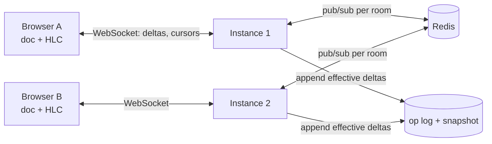

# Canvas: a collaborative whiteboard on a hand-written CRDT


**Live demo → _coming soon_**

A real-time multiplayer whiteboard: share a link and draw together with live cursors. It keeps working **offline**: edit in two tabs while one is disconnected, reconnect, and both converge to the same board with nothing lost. Sync is a CRDT I wrote myself, about 80 lines in each language, with the server and browser checked against the same test cases.

<!-- Add a GIF: two windows, one goes offline, both draw, reconnect and merge: docs/demo.gif -->

## What it shows

| | |
|---|---|
| **A CRDT from scratch** | Each shape is a map of last-writer-wins fields ordered by hybrid logical clocks. Merge is a per-field max, so it's commutative, associative and idempotent. Property-tested: 200 random histories delivered shuffled, duplicated and in random batches always converge. |
| **Offline-first** | Edits queue locally while disconnected and merge on reconnect. Verified live: one tab moved a shape offline while the other moved it and erased another; after reconnecting both held **byte-identical state**, with every conflict resolved by the rules below. |
| **Two implementations, one spec** | `app/crdt.py` (server) and `static/crdt.js` (browser) run the same fixture file: pytest locally, `node --test` in CI. |
| **Horizontal scaling** | Any instance serves any room: instances share room traffic over Redis pub/sub, so there are no sticky sessions. A new instance asks "who's here?" so presence is complete. (A test caught that missing step.) |
| **Coordination-free persistence** | An append-only op log plus snapshots. Since merge is idempotent, the log may hold duplicates or overlap the snapshot and loading is still correct, so writers never lock. Only compaction takes a short lock. |
| **Backpressure** | Edits are never dropped: a client too slow to keep up is disconnected and resyncs from a snapshot on reconnect. Cursor updates are disposable and skipped first. Per-connection rate limits, room and board size caps. |
| **Defending last-writer-wins** | Timestamps more than 60 s in the future are rejected. Otherwise one skewed (or malicious) clock would win every conflict forever. |
| **Interface craft** | Infinite canvas with momentum panning (Apple's deceleration curve), rubber-banded pinch zoom that springs back, 1:1 dragging that respects the grab point, remote cursors smoothed by per-axis springs, undo/redo as plain CRDT writes, floating translucent chrome. |
| **Testing** | 286 Python tests (CRDT properties, rooms across two instances, WebSockets end to end, Redis compaction and pub/sub) plus the JS suite in CI. |

## How the sync works

```
doc   = { shape_id: { field: [value, ts] } }
ts    = [wall_ms, counter, client_id]      compared as a tuple
merge = for each field, keep the larger ts
```

**Hybrid logical clocks.** Each client's clock uses wall time when it advances, a counter when it doesn't, and never falls behind a timestamp it has seen. So causally-later edits always get larger timestamps even when machine clocks disagree, and the client id breaks exact ties deterministically.

**Conflict rules that fall out of this**

| Concurrent edits | Result |
|---|---|
| Two people move the same shape | The later move wins (by HLC) |
| One moves it, one deletes it | Both writes apply (different fields), so it stays deleted |
| One changes color, one moves it | Both apply: no conflict at all |
| Undo | A newer write of the old value, so it merges like any other edit |



The server merges every incoming batch and forwards only the **effective delta** (fields that actually changed), so stale or duplicate updates cost nothing downstream. The browser coalesces edits every 50 ms: a stroke growing point by point becomes one op per flush.

```
app/
├── crdt.py       the merge rules, validation, timestamp drift bound
├── rooms.py      membership, fan-out, rate limits, backpressure, cross-instance relay
├── store.py      op log + snapshot (memory or Redis), pub/sub bus (memory or Redis)
├── main.py       HTTP + WebSocket endpoints
└── static/
    ├── crdt.js   the same rules in the browser, plus the hybrid logical clock
    └── board.js  canvas, tools, gestures, presence, offline queue
```

## Design decisions & trade-offs

**Why not Yjs/Automerge?** They're the right call for a product. Here the point was to show I understand *why* they work: the properties a merge needs, what clocks to use, and where last-writer-wins breaks. The whole sync layer is small enough to read in one sitting.

**State-based deltas, not operations.** Ops ("move by +10") need exactly-once, in-order delivery. State deltas ("x is 110 as of ts") can be duplicated and reordered freely, which is what makes reconnects, retries and multi-instance fan-out simple.

**Where LWW falls short.** Two people typing in the *same* sticky note at the same moment: one version wins whole. Character-level merging needs a sequence CRDT (RGA, or Yjs's YATA). Strokes are similar: a stroke's points are one field, so they're sent whole (coalesced every 50 ms). Fine for drawing, not for long documents.

**Tombstones.** Deleted shapes stay as `deleted: true`, so a late edit can't resurrect them. They cost memory; production systems garbage-collect tombstones once every replica has seen them.

**Fresh client id per page load.** If two tabs shared an id, they could produce identical timestamps for different values, the one case the merge can't order. A per-load id (and the server rejecting duplicates) rules that out.

**Pub/sub is fire-and-forget.** If an instance misses bus messages, its clients still converge: on reconnect they get a full snapshot from the log. The bus only has to be fast, not reliable.

## Performance

`k6 run loadtest/k6.js` against `docker compose up` (2 instances + Redis + nginx): users in rooms of 10, each sending 20 cursor moves/s and an edit per second, ramping to 500 concurrent connections. Latency is measured from send to every other member receiving it.

| Metric | Result |
|---|---|
| Concurrent connections | _fill in_ |
| Fan-out latency p50 / p95 / p99 | _fill in_ |
| Messages delivered per second | _fill in_ |
| Hardware | _fill in_ |

## Scaling it further

1. **Shard rooms.** Pub/sub fan-out means every instance subscribed to a room hears all its traffic. With many rooms, route each room to a home instance with consistent hashing (project #5 visualizes exactly that) and use pub/sub only for overflow.
2. **Binary encoding.** JSON is readable but heavy for cursors; a compact binary format (or MessagePack) cuts bandwidth several-fold.
3. **Smarter snapshots.** Snapshot on a timer per active room, store snapshots in object storage, and keep only a short op tail in Redis.
4. **Tombstone GC** once all replicas have acknowledged a deletion.
5. **Edge relays.** Put WebSocket termination close to users (regional instances) and replicate room traffic between regions; the CRDT tolerates the extra delay.

## Running it

```bash
python -m venv .venv && source .venv/bin/activate   # Windows: .venv\Scripts\activate
pip install -r requirements-dev.txt
uvicorn app.main:app --reload
# → http://localhost:8000 (redirects to a fresh board; open the link in two windows)
```

**Two instances + Redis:** `docker compose up --build` → http://localhost:8080

**Tests:** `pytest` (Python) and `node --test tests/js/` (browser CRDT, Node 22+).

**Deploying for free:** one container handles many rooms with the in-memory store. Add a free Redis (e.g. Upstash) via `REDIS_URL` for persistence across restarts and multiple instances. The host must support WebSockets.

## Protocol

| Direction | Message |
|---|---|
| → server | `{t: "ops", ops: [{id, f: {field: [value, ts]}}]}` · `{t: "cursor", x, y}` |
| ← server | `welcome {you, doc, peers}` · `ops {ops, from}` · `cursor {id, cursor}` · `join {peer}` · `leave {id}` · `error {message}` |

Endpoint: `WS /ws/{room}?client=<id>&name=<name>`. Limits: 30 people and 5,000 shapes per board, 30 edits/s per connection, 256 KB per message.
